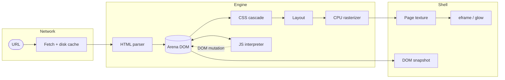

<div align="center">

# Mazda Browser

**A browser engine written in Rust from scratch.**
No third-party engine code — just a renderer built around one question:
*how little RAM can a browser use?*

[](https://www.rust-lang.org/)
[](LICENSE)
[](https://github.com/2sulraw/mazda-browser)
[](#status)
[](#status)

[Features](#features) · [Architecture](#architecture) · [Quick start](#quick-start) · [Configuration](#configuration) · [Memory](#memory) · [Plan](PLAN.md)

</div>

---

## Why another browser?

Modern browsers ship a GPU process, a JIT, and a per-tab process model before they render a
single paragraph. Mazda starts from the other end: **one process, a CPU rasterizer, an arena
DOM, and a small interpreter**, with the memory curve as the primary design constraint.

The result is not a Chrome replacement. It is a readable engine that renders real sites — and
that gets cheaper per tab instead of more expensive.

## Features

| | Area | What's inside |
|---|---|---|
| 🧱 | **HTML & DOM** | Streaming tokenizer → arena DOM (`u32` indices, interned tags), declarative shadow DOM, inline `<svg>` |
| 🎨 | **CSS** | Type/class/id/attribute selectors, `:is()`/`:where()`/`:not()`/`:has()`, `nth-child`, cascade + specificity, `var()`, `@layer`, `@supports`, `calc()`, `light-dark()` |
| 📐 | **Layout** | Block flow, flexbox (wrap/grow/shrink/basis), grid (fr, `repeat()`, named lines), relative/absolute/fixed/sticky, borders, radius, shadow, `clip-path` |
| 🖌️ | **Rendering** | CPU software rasterizer, word wrap, text decorations, backgrounds, `:hover` restyling, cursor changes, link hit-testing |
| 🖼️ | **Images** | PNG, JPEG, WebP, hand-written SVG rasterizer, `srcset`; probe-then-decode with a per-page pixel budget |
| 🔤 | **Text** | Charset detection, gzip, CJK/Hangul fallback, `@font-face` (WOFF1, optional WOFF2), font stacks |
| ⚙️ | **JavaScript** | From-scratch interpreter: classes, modules, promises, builtins, DOM APIs, events, `fetch`, timers — plus an optional full engine core |
| 🌐 | **Networking** | HTTP(S) with a Chrome-shaped TLS/header profile (rustls: Chrome cipher + curve order, UA/client hints), disk cache, persisted cookie jar, gzip |
| 🪟 | **Shell** | Tabs, history, address bar, scrollbar, form controls, hover, F11, settings overlay, element inspector, drag-select + copy, load progress bar, right-click menu, live RSS meter |
| 🧠 | **Memory** | Worker-thread loading, DOM snapshots for tab restore, lazy fonts, hard decode budgets |

## Architecture



- **One thread for UI, one for the page.** Fetch, parse, cascade, layout, and JS run on a
  worker; the shell keeps painting.
- **Arena, not pointers.** Nodes are `u32` indices; tags are `u16` IDs. No per-node `String`s.
- **Decode only what is visible.** Images are probed, then decoded straight to display size.
- **Restore, don't refetch.** Tab switches and back-navigation replay a serialized DOM snapshot.

## Quick start

Requires **Rust 1.96+**.

```bash
git clone https://github.com/2sulraw/mazda-browser.git
cd mazda-browser
cargo run --release -- https://example.com/
```

Or build the binary and run it directly:

```bash
cargo build --release
target\release\mazda.exe https://example.com/    # Windows
./target/release/mazda https://example.com/      # Linux
```

> Windows is the primary target. The Linux paths compile but are not regularly exercised.

Run the test suite:

```bash
cargo test
```

Optional build features:

```bash
cargo build --release --features woff2      # WOFF2 webfonts
cargo build --release --features engine-b   # engine B (boa) selectable
```

## Configuration

Click the ⚙ button in the toolbar, or edit `%LOCALAPPDATA%\mazda.conf` directly:

```ini
engine=a   # a = built-in pure-Rust interpreter (default), b = engine B
fonts=a    # a = WOFF2 webfonts, b = system fonts only
```

Resolution order, per setting:

```text
--engine= / --fonts=  >  MAZDA_ENGINE / MAZDA_FONTS  >  mazda.conf  >  default a
```

Both choices are independent and apply on the next navigation. Engine B only runs in builds
compiled with `--features engine-b`.

## Memory

Measured RSS on Windows 11 with the status-bar meter:

| Scenario | RSS |
|---|---:|
| Idle window | ~106 MB |
| Wikipedia article | ~100 MB |
| MDN reference page | ~80–95 MB |
| google.com homepage | ~92 MB |
| Additional tabs | restored from snapshots — no live renderer |

The `glow`/winit GL context sets the floor. The real target is the **shape of the curve**: a
hibernated tab costs a serialized DOM, not a second browser. Every dependency adoption is
measured; the full log lives in [PLAN.md](PLAN.md).

## Status

Mazda is **alpha** — it renders Wikipedia, MDN, Hacker News, rust-lang.org, nextjs.org, and
google.com, and runs real page scripts, but it is not a daily driver.

- **In scope:** HTML/CSS/layout, images, fonts, a JavaScript interpreter, forms, tabs
- **Not yet:** GPU compositing, process sandbox, media playback (`<video>`/`<audio>` render a
  labelled placeholder; `play()`/EME reject with `NotSupportedError` instead of being absent),
  DRM, extensions, full DevTools
- **Not a near-term target:** Chrome-scale JS applications — that needs their API surface and a JIT

> JavaScript was originally a non-goal. It is now in scope as a from-scratch interpreter, with
> an optional full engine core selectable at runtime.

Phase status, measurements, and recorded decisions: **[PLAN.md](PLAN.md)**.

## License

[MIT](LICENSE) © 2026 2sulraw

<div align="center">
<sub>Built from scratch, one layout pass at a time.</sub>
</div>
